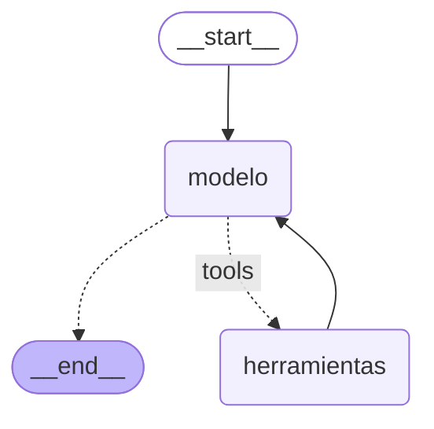

# Pre-entrega 5: Agente ReAct con memoria persistente

Este es un agente que responde preguntas sobre clientes y sus pedidos. Está construido con **LangGraph** y usa **Claude Haiku 5.5** como modelo.

- **Razona en varios pasos.** Para saber cuántos pedidos tiene "María López", primero tiene que buscar su ID y recién después consultar sus pedidos. Ninguna herramienta responde la pregunta por sí sola, así que el agente se ve obligado a encadenarlas.
- **Recuerda la conversación.** Si después de preguntar por María le preguntas "¿Y Juan Pérez?", entiende que quieres lo mismo, pero para Juan. Esa memoria queda guardada en SQLite, así que sobrevive aunque cierres el programa.
- **No inventa datos.** Si le preguntas por alguien que no existe, la herramienta le devuelve un error, y el agente te lo explica y te pide que verifiques el nombre en vez de inventar una respuesta.

---

## Cómo levantarlo

Necesitas [uv](https://docs.astral.sh/uv/) y una API key de Anthropic.

```bash
# 1. Instalar dependencias (uv crea el entorno con Python 3.12)
uv sync

# 2. Configurar la API key
cp .env.example .env
# Abre .env y pega tu ANTHROPIC_API_KEY

# 3. Ejecutar el agente
uv run agente
```

El comando corre tres escenarios de prueba, muestra las respuestas en la consola y deja la traza completa en `traces/traza_ejecucion.json`. Cada ejecución usa conversaciones nuevas (con un `thread_id` único), así que puedes correrlo las veces que quieras sin que se mezclen con las anteriores.

### ¿No tienes una API key a mano?

No hay problema. Abajo está la salida real de una ejecución, y la traza completa de esa misma corrida ya viene incluida en el repo ([`traces/traza_ejecucion.json`](traces/traza_ejecucion.json)). Además, las pruebas automatizadas (más abajo) corren **sin credenciales**.

Esto es lo que muestra `uv run agente` en la consola:

```text
[memoria] ¿Cuántos pedidos tuvo María López y cuál fue el total?
→ María López tiene **6 pedidos**, con un monto total de **$31.400** CLP. Su último pedido fue el 3 de octubre de 2026.

[memoria] ¿Y Juan Pérez?
→ Juan Pérez tiene **2 pedidos**, con un monto total de **$7.500** CLP. Su último pedido fue el 22 de julio de 2026.

[ciclo_retorno] ¿Cuántos pedidos tuvo Roberto Sánchez?
→ No pude encontrar a ningún cliente llamado "Roberto Sánchez" en el sistema. ¿Podrías verificar si el nombre está escrito correctamente? Si tienes otro nombre, apellido o el ID del cliente, también puedo intentar buscarlo con eso.

Traza guardada en traces/traza_ejecucion.json
```

Como el modelo genera texto, las respuestas pueden variar un poco en la redacción entre una ejecución y otra, pero los datos (6 pedidos, $31.400, etc.) salen siempre de las herramientas.

---

## Pruebas automatizadas

```bash
uv run pytest            # 18 pruebas, sin API key y en menos de un segundo
uv run pytest -m integracion   # 1 prueba extra contra Claude real (necesita la key)
```

La mayoría de las pruebas no llaman a la API. Para probar el grafo uso un **modelo falso** (`GenericFakeChatModel`) que devuelve respuestas guionadas: por ejemplo, "primero pide `buscar_cliente_por_nombre`, después `buscar_pedidos`, después responde". Lo único que se reemplaza es el LLM; los nodos, las aristas, el `ToolNode` y las herramientas son los de verdad. Así se puede comprobar que el grafo funciona sin depender de credenciales ni de que el modelo responda siempre igual.

| Archivo | Qué prueba |
|---|---|
| [`tests/test_tools.py`](tests/test_tools.py) | Que la búsqueda ignore tildes, mayúsculas y espacios, y que las herramientas devuelvan `ERROR` en vez de lanzar excepciones |
| [`tests/test_graph.py`](tests/test_graph.py) | El ciclo del grafo, el multi-paso, el ciclo de retorno, la memoria aislada por `thread_id` y la limpieza de los bloques de razonamiento |
| [`tests/test_main.py`](tests/test_main.py) | Que la traza registre solo lo nuevo de cada turno y que el JSON se guarde con las tildes legibles. Incluye la prueba de integración, que se salta sola si no hay key |

---

## Cómo está armado

```
src/agente/
├── __init__.py   # carga el .env antes que todo lo demás
├── tools.py      # la "base de datos" simulada y las dos herramientas
├── graph.py      # el estado, los nodos y el grafo ReAct
└── main.py       # los escenarios de prueba, la persistencia y la traza
tests/            # pruebas automatizadas con pytest
traces/
└── traza_ejecucion.json
```

### El grafo



Es el ciclo clásico de ReAct:

1. El nodo **`modelo`** recibe la conversación y decide qué hacer: o pide una herramienta o responde directamente.
2. Si pidió una herramienta, `tools_condition` lo manda al nodo **`herramientas`**, que la ejecuta.
3. El resultado vuelve a **`modelo`** (la flecha `herramientas → modelo` es la que cierra el ciclo) y el modelo decide de nuevo.
4. Cuando ya tiene todo lo que necesita, responde y el grafo termina.

El diagrama no lo dibujé a mano: sale de `construir_grafo().compile().get_graph().draw_mermaid()`.

### Las herramientas

En [`tools.py`](src/agente/tools.py) hay dos "tablas" separadas a propósito:

| Herramienta | Recibe | Devuelve |
|---|---|---|
| `buscar_cliente_por_nombre` | el nombre del cliente | su `cliente_id` |
| `buscar_pedidos` | el `cliente_id` | la cantidad de pedidos, el total y la fecha del último |

Como los pedidos se buscan por ID y el usuario siempre pregunta por nombre, el razonamiento en dos pasos es inevitable. Además, la búsqueda por nombre no distingue mayúsculas, tildes ni espacios de más: "maria lopez", "María López" y "MARÍA  LÓPEZ" encuentran a la misma persona.

---

## Lo que muestra la traza

`uv run agente` ejecuta estos tres escenarios:

| # | Pregunta | `thread_id` | Qué demuestra |
|---|---|---|---|
| 1 | ¿Cuántos pedidos tuvo María López y cuál fue el total? | `memoria-…` | Dos herramientas encadenadas: el ID que devuelve la primera es el argumento de la segunda |
| 2 | ¿Y Juan Pérez? | el mismo que el 1 | Memoria: la pregunta está incompleta y el agente la entiende por el contexto |
| 3 | ¿Cuántos pedidos tuvo Roberto Sánchez? | `ciclo-retorno-…` (otro) | Ciclo de retorno: la herramienta falla, el agente lo reconoce y pide aclaración |

La traza guarda **solo lo nuevo de cada turno**, no el historial completo una y otra vez. Para lograrlo uso `astream(..., stream_mode="updates")`, que entrega lo que produjo cada nodo en ese momento.

Este es el escenario 3 tal como quedó en la traza:

```json
{
  "escenario": "ciclo_retorno",
  "pregunta": "¿Cuántos pedidos tuvo Roberto Sánchez?",
  "pasos": [
    { "nodo": "usuario", "tipo": "human",
      "contenido": "¿Cuántos pedidos tuvo Roberto Sánchez?" },
    { "nodo": "modelo", "tipo": "ai", "contenido": "",
      "tool_calls": [{ "nombre": "buscar_cliente_por_nombre", "args": { "nombre": "Roberto Sánchez" } }] },
    { "nodo": "herramientas", "tipo": "tool", "herramienta": "buscar_cliente_por_nombre",
      "contenido": "ERROR: No se encontró ningún cliente con el nombre 'Roberto Sánchez'. Verifica que esté escrito correctamente." },
    { "nodo": "modelo", "tipo": "ai",
      "contenido": "No pude encontrar a ningún cliente llamado \"Roberto Sánchez\" en el sistema. ¿Podrías verificar si el nombre está escrito correctamente? Si tienes otro nombre, apellido o el ID del cliente, también puedo intentar buscarlo con eso." }
  ]
}
```

Fíjate en el campo `nodo`: ahí se ve el recorrido por el grafo (`usuario → modelo → herramientas → modelo`).

---

## Checklist de la entrega

| Requisito | Dónde se cumple |
|---|---|
| Estado que hereda de `MessagesState` | `AgenteState` en [`graph.py`](src/agente/graph.py) |
| Nodo del modelo asíncrono | `nodo_modelo` (`async def` + `ainvoke`) en [`graph.py`](src/agente/graph.py) |
| Nodo de herramientas | `ToolNode(tools=herramientas)` en `construir_grafo` |
| Arista condicional y ciclo | `add_conditional_edges` con `tools_condition`, más la arista `herramientas → modelo` |
| Al menos dos herramientas con docstrings claros | [`tools.py`](src/agente/tools.py) |
| Razonamiento multi-paso (≥ 2 llamadas) | Escenario 1 de la traza |
| Ciclo de retorno ante errores | Escenario 3 de la traza: las herramientas *devuelven* `ERROR` en vez de lanzar excepciones |
| Persistencia con checkpointer async | `AsyncSqliteSaver` en `main()`, [`main.py`](src/agente/main.py) |
| `thread_id` y `recursion_limit` | El `config` dentro de `ejecutar_turno` en [`main.py`](src/agente/main.py) |
| Manejo del estado (que no crezca sin control) | `trim_messages` en `nodo_modelo` |
| Traza de ejecución | [`traces/traza_ejecucion.json`](traces/traza_ejecucion.json) |
| Pruebas automatizadas | [`tests/`](tests/), con `uv run pytest` |
| API key fuera del repo | `.env` está en `.gitignore`; el repo solo incluye `.env.example` |

---

## Decisiones técnicas (y por qué)

**`AsyncSqliteSaver` en vez de `SqliteSaver`.** Todo el grafo es asíncrono (`ainvoke`, `astream`), y el `SqliteSaver` normal es síncrono y no funciona en ese contexto. La versión async usa `aiosqlite` por debajo. Va dentro de un `async with` para que la conexión se cierre bien al terminar.

**`add_messages` y no `operator.add`.** El enunciado menciona `operator.add` para acumular mensajes, pero `MessagesState` ya trae su propio reducer, `add_messages`, que es mejor: además de agregar los mensajes nuevos, reemplaza los que llegan con un `id` que ya existe en vez de duplicarlos. Por eso `AgenteState` hereda de `MessagesState` sin redefinir nada.

**Los errores se devuelven, no se lanzan.** Si una herramienta lanzara una excepción, el grafo se caería. Al devolver un texto que empieza con `ERROR:`, el modelo lo lee como cualquier otro resultado y puede reaccionar: reintentar o, como en el escenario 3, pedirle una aclaración al usuario. El system prompt refuerza esto con la instrucción de no inventar nunca datos.

**El historial se recorta antes de enviarlo.** `nodo_modelo` usa `trim_messages` para mandarle al modelo solo los últimos 20 mensajes, empezando siempre en una pregunta del usuario (`start_on="human"`) para no dejar resultados de herramientas "huérfanos". El checkpointer igual guarda la conversación completa; lo que se limita es lo que ve el modelo en cada llamada.

**Limpieza de los bloques de razonamiento.** Este fue el bug más difícil del proyecto. Claude Haiku 5.5 a veces "piensa" antes de responder, y ese razonamiento viene firmado y ligado a todo lo que había antes en la conversación. Cuando el recorte saca los mensajes más antiguos, esas firmas dejan de calzar y la API rechaza la petición. La función `quitar_thinking_previo` elimina esos bloques de los turnos anteriores, pero mantiene los del turno en curso, porque la API los necesita para continuar el ciclo de herramientas.

**El `.env` se carga en `__init__.py`.** Al principio el `load_dotenv()` estaba en `main.py`, pero `graph.py` crea el cliente de Anthropic apenas se importa, o sea antes de que se leyera la key. Moverlo a `__init__.py` asegura que la key esté disponible antes que cualquier otra cosa.

---

## Limitaciones conocidas

- **El recorte borra la memoria lejana sin avisar.** Si una conversación pasa los 20 mensajes, el modelo deja de ver el comienzo. Lo noté probando: el modelo mencionaba una "corrección anterior" que ya no podía ver, y se confundía. Una mejora natural sería **resumir** los mensajes antiguos en vez de cortarlos.
- **La base de datos es un diccionario en memoria.** Sirve para demostrar el flujo, pero en un caso real las herramientas consultarían una base de datos de verdad.
- **El mensaje de error no sugiere nombres parecidos.** Si escribes mal un nombre, el agente te pide verificarlo, pero no te propone opciones similares.

---

## Stack

Python 3.12 · uv · LangGraph · LangChain · Claude Haiku 5.5 (`langchain-anthropic`) · SQLite (`langgraph-checkpoint-sqlite` + `aiosqlite`) · pytest
