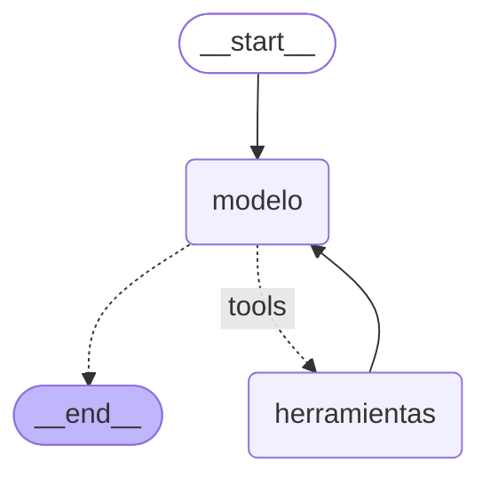

# Pre-entrega 5: Agente de razonamiento cíclico con memoria persistente

Este es un agente que responde preguntas sobre clientes y sus pedidos. Está construido con **LangGraph** (`StateGraph` + `MessagesState`), usa **Claude Haiku 5.5** con herramientas vinculadas mediante `llm.bind_tools()` y guarda la memoria en SQLite con el checkpointer **`SqliteSaver`**, en su versión asíncrona `AsyncSqliteSaver`.

- **Razona en varios pasos.** Para saber cuántos pedidos tiene "María López", primero busca su ID y recién después consulta sus pedidos: dos llamadas a herramientas para llegar a una respuesta.
- **Recuerda la conversación, incluso después de cerrar la conexión.** La memoria vive en `checkpoints.sqlite`. Una conexión nueva recupera el historial del mismo `thread_id` y la conversación continúa.
- **No inventa datos.** Si una herramienta devuelve un error, el agente lo explica y pide una aclaración.

**Dónde está todo:** el grafo y el estado en [`src/agente/graph.py`](src/agente/graph.py), las herramientas en [`src/agente/tools.py`](src/agente/tools.py), la persistencia y los escenarios en [`src/agente/main.py`](src/agente/main.py) y la traza ReAct en [`traces/traza_ejecucion.log`](traces/traza_ejecucion.log) (texto) y [`traces/traza_ejecucion.json`](traces/traza_ejecucion.json) (JSON).

---

## Evidencia por criterio de evaluación

### 1. Arquitectura del Grafo y Gestión de Estado (30%)

**El estado hereda de `MessagesState`** ([`graph.py`](src/agente/graph.py), `AgenteState`). `MessagesState` define la clave `messages` con el reducer `add_messages`, que cumple el rol de `operator.add`: cada nodo devuelve solo sus mensajes nuevos y el reducer los agrega al historial, así el diálogo se mantiene coherente de un turno a otro.

```python
class AgenteState(MessagesState):
    """Estado del grafo: hereda de MessagesState la clave `messages`. ..."""
```

**El `StateGraph` conecta el modelo con las herramientas mediante `tools_condition`** ([`graph.py`](src/agente/graph.py), `construir_grafo`):

```python
grafo = StateGraph(AgenteState)
grafo.add_node("modelo", nodo_modelo)                       # nodo async del LLM
grafo.add_node("herramientas", ToolNode(tools=herramientas))
grafo.add_edge(START, "modelo")
grafo.add_conditional_edges("modelo", tools_condition, {"tools": "herramientas", END: END})
grafo.add_edge("herramientas", "modelo")                    # el ciclo ReAct
```



(El diagrama se generó desde el código con `construir_grafo().compile().get_graph().draw_mermaid()`.)

**El estado no crece sin control (evita el "Estado Sucio").** `nodo_modelo` le envía al modelo solo los últimos 20 mensajes con `trim_messages`, empezando siempre en un mensaje del usuario para no dejar resultados de herramientas huérfanos. El checkpointer conserva el historial completo; lo que se limita es lo que ve el modelo en cada llamada.

**Autonomía: no hay rutas `if/else` manuales.** Es el modelo el que decide si llama a una herramienta; `tools_condition` solo lee esa decisión (si el último mensaje trae `tool_calls`) y enruta.

### 2. Integración de Herramientas y Razonamiento Multi-paso (35%)

**Dos herramientas propias con `@tool`** que simulan consultas a una base de datos ([`tools.py`](src/agente/tools.py)), vinculadas al LLM con `llm.bind_tools(herramientas)` ([`graph.py`](src/agente/graph.py)):

| Herramienta | Recibe | Devuelve |
|---|---|---|
| `buscar_cliente_por_nombre` | el nombre del cliente | su `cliente_id` |
| `buscar_pedidos` | el `cliente_id` | la cantidad de pedidos, el total y la fecha del último |

Las tablas están separadas a propósito: los pedidos se buscan por ID y el usuario pregunta por nombre, así que **ninguna herramienta responde sola** y el agente tiene que encadenarlas. Los docstrings le indican al modelo cuándo usar cada una y en qué orden.

**Traza real del escenario 1: dos llamadas, y el resultado de la primera es el argumento de la segunda** ([`traces/traza_ejecucion.log`](traces/traza_ejecucion.log)):

```text
=== [multi_paso] thread_id=memoria-5dbc06ce
[usuario] ¿Cuántos pedidos tuvo María López y cuál fue el total?
[modelo] → llama buscar_cliente_por_nombre({'nombre': 'María López'})
[herramientas] ← buscar_cliente_por_nombre: Cliente encontrado: María López con cliente_id=310
[modelo] → llama buscar_pedidos({'cliente_id': 310})
[herramientas] ← buscar_pedidos: pedidos=6, total=$31400, ultimo_pedido=2026-10-03
[modelo] María López tuvo **6 pedidos** y el monto total gastado fue de **$31.400 CLP**. Su último pedido fue el 3 de octubre de 2026.
```

**Ciclo de retorno: cuando una herramienta falla, el agente pide aclaración.** Las herramientas *devuelven* un texto `ERROR: ...` en vez de lanzar una excepción, así el modelo lo lee y reacciona:

```text
=== [ciclo_retorno] thread_id=ciclo-retorno-6c207076
[usuario] ¿Cuántos pedidos tuvo Roberto Sánchez?
[modelo] → llama buscar_cliente_por_nombre({'nombre': 'Roberto Sánchez'})
[herramientas] ← buscar_cliente_por_nombre: ERROR: No se encontró ningún cliente con el nombre 'Roberto Sánchez'. Verifica que esté escrito correctamente.
[modelo] No encontré ningún cliente registrado con el nombre "Roberto Sánchez". ¿Podrías verificar que el nombre esté escrito correctamente? Si tienes otro dato, como el ID del cliente o un nombre alternativo, también puedo intentar buscarlo con eso.
```

**Límite de recursión.** Cada invocación del grafo lleva `"recursion_limit": 10` ([`main.py`](src/agente/main.py), `ejecutar_turno`), para que un ciclo modelo ↔ herramientas nunca quede corriendo sin techo.

### 3. Persistencia con SqliteSaver (20%)

El checkpointer es **`AsyncSqliteSaver`**, la variante asíncrona de `SqliteSaver` del paquete `langgraph-checkpoint-sqlite`. Uso la versión async porque todo el grafo es asíncrono (`ainvoke` y `astream`, con `asyncio`), y el `SqliteSaver` síncrono no funciona en ese contexto. Guarda el estado de cada `thread_id` en el archivo `checkpoints.sqlite`.

La demo prueba la persistencia en dos niveles ([`main.py`](src/agente/main.py), `main`):

1. **Memoria dentro de la sesión.** Después de preguntar por María López, la pregunta "¿Y Juan Pérez?" (mismo `thread_id`) se entiende por el contexto.
2. **Memoria que sobrevive a cerrar la conexión.** Se cierra la conexión a SQLite, se abre una nueva, se recompila el grafo y se continúa el mismo `thread_id`:

```python
# Sesión 1: escenarios 1 a 3
async with AsyncSqliteSaver.from_conn_string("checkpoints.sqlite") as checkpointer:
    app = construir_grafo().compile(checkpointer=checkpointer)
    ...
# La conexión ya se cerró: lo único que queda es el archivo .sqlite.

# Sesión 2: conexión nueva, mismo thread_id
async with AsyncSqliteSaver.from_conn_string("checkpoints.sqlite") as checkpointer:
    app = construir_grafo().compile(checkpointer=checkpointer)
    estado_recuperado = await app.aget_state(config)   # 12 mensajes recuperados
```

En la traza, el agente responde la pregunta del escenario 4 **sin llamar a ninguna herramienta**: los datos de María y Juan salen del historial recuperado de SQLite.

```text
=== [persistencia_sqlite] thread_id=memoria-5dbc06ce
    (conexión nueva a SQLite: se recuperaron 12 mensajes del thread)
[usuario] De los dos clientes que te pregunté, ¿cuál gastó más en total?
[modelo] María López gastó más en total: **$31.400 CLP** frente a los **$7.500 CLP** de Juan Pérez. La diferencia es de **$23.900 CLP**.
```

Además, la prueba automatizada `test_persistencia_sobrevive_a_cerrar_la_conexion_sqlite` comprueba lo mismo sobre un archivo SQLite real, sin usar la API.

### 4. Calidad del Repositorio y Entorno Profesional (15%)

- **Python 3.12** fijado en `.python-version` y en `requires-python`.
- **Type hints** en todas las funciones y **`asyncio`** en todo el flujo (`async def`, `ainvoke`, `astream`, `AsyncSqliteSaver`).
- **Dependencias declaradas** en `pyproject.toml`, con las versiones exactas fijadas en `uv.lock`. Se instala con `uv` o con `venv` + `pip` (ver abajo).
- **Credenciales fuera del repo:** la API key se lee desde `.env`, que está en `.gitignore`. El repo solo incluye `.env.example`.
- **Código separado por responsabilidad:** herramientas, grafo y ejecución en módulos distintos.
- **19 pruebas automatizadas con pytest** que corren sin API key.

---

## Cómo levantarlo

Necesitas Python 3.12 y una API key de Anthropic. Elige una de estas dos opciones.

**Opción A: con `venv` y `pip`**

```bash
python3.12 -m venv .venv
source .venv/bin/activate          # en Windows: .venv\Scripts\activate
pip install -e .

cp .env.example .env               # abre .env y pega tu ANTHROPIC_API_KEY
python -m agente
```

**Opción B: con [uv](https://docs.astral.sh/uv/)**

```bash
uv sync
cp .env.example .env               # abre .env y pega tu ANTHROPIC_API_KEY
uv run agente
```

El comando corre los cuatro escenarios, muestra las respuestas en la consola y deja la traza en `traces/traza_ejecucion.log` y `traces/traza_ejecucion.json`. Cada ejecución usa `thread_id` nuevos, así que puedes correrlo las veces que quieras sin que se mezcle con las anteriores.

### ¿No tienes una API key a mano?

No hay problema: la traza de una ejecución real ya viene en el repo ([`traces/`](traces/)), y las pruebas automatizadas corren **sin credenciales**. Esta es la salida de consola de esa misma ejecución:

```text
[multi_paso] ¿Cuántos pedidos tuvo María López y cuál fue el total?
→ María López tuvo **6 pedidos** y el monto total gastado fue de **$31.400 CLP**. Su último pedido fue el 3 de octubre de 2026.

[memoria] ¿Y Juan Pérez?
→ Juan Pérez tuvo **2 pedidos** por un total de **$7.500 CLP**. Su último pedido fue el 22 de julio de 2026.

[ciclo_retorno] ¿Cuántos pedidos tuvo Roberto Sánchez?
→ No encontré ningún cliente registrado con el nombre "Roberto Sánchez". ¿Podrías verificar que el nombre esté escrito correctamente? Si tienes otro dato, como el ID del cliente o un nombre alternativo, también puedo intentar buscarlo con eso.

(Conexión nueva a SQLite: 12 mensajes recuperados de memoria-5dbc06ce)

[persistencia_sqlite] De los dos clientes que te pregunté, ¿cuál gastó más en total?
→ María López gastó más en total: **$31.400 CLP** frente a los **$7.500 CLP** de Juan Pérez. La diferencia es de **$23.900 CLP**.

Traza guardada en traces/traza_ejecucion.json
Log guardado en traces/traza_ejecucion.log
```

Como el modelo genera texto, la redacción puede variar un poco entre ejecuciones, pero los datos (6 pedidos, $31.400, etc.) salen siempre de las herramientas.

---

## Escenarios de la demo

| # | Pregunta | `thread_id` | Qué demuestra |
|---|---|---|---|
| 1 | ¿Cuántos pedidos tuvo María López y cuál fue el total? | `memoria-…` | Multi-paso: dos herramientas encadenadas |
| 2 | ¿Y Juan Pérez? | el mismo que el 1 | Memoria dentro de la sesión |
| 3 | ¿Cuántos pedidos tuvo Roberto Sánchez? | `ciclo-retorno-…` (otro) | Ciclo de retorno: error de la herramienta y pedido de aclaración |
| 4 | De los dos clientes que te pregunté, ¿cuál gastó más en total? | el mismo que el 1, **con una conexión nueva a SQLite** | Persistencia: el historial se recupera del archivo |

La traza guarda **solo lo nuevo de cada turno**, sin repetir el historial: uso `astream(..., stream_mode="updates")`, que entrega lo que produjo cada nodo. El campo `nodo` de la traza muestra el recorrido por el grafo (`usuario → modelo → herramientas → modelo`).

---

## Pruebas automatizadas

```bash
uv run pytest                   # 19 pruebas, sin API key
uv run pytest -m integracion    # 1 prueba extra contra Claude real (necesita la key)
```

Con la opción A (venv), instala antes las herramientas de prueba con `pip install pytest pytest-asyncio` y luego corre `pytest`.

Para probar el grafo sin la API uso un **modelo falso** (`GenericFakeChatModel`) que devuelve respuestas guionadas. Lo único que se reemplaza es el LLM: los nodos, las aristas, el `ToolNode` y las herramientas son los reales.

| Archivo | Qué prueba |
|---|---|
| [`tests/test_tools.py`](tests/test_tools.py) | Búsqueda tolerante a tildes, mayúsculas y espacios; herramientas que devuelven `ERROR` en vez de lanzar excepciones |
| [`tests/test_graph.py`](tests/test_graph.py) | Herencia de `MessagesState`, el ciclo del grafo, el multi-paso, el ciclo de retorno, la memoria por `thread_id`, **la persistencia en SQLite al reabrir la conexión** y la limpieza del historial |
| [`tests/test_main.py`](tests/test_main.py) | La traza (solo lo nuevo de cada turno, tildes legibles) y la prueba de integración, que se salta sola si no hay key |

---

## Estructura del proyecto

```
src/agente/
├── __init__.py   # carga el .env antes que todo lo demás
├── __main__.py   # permite ejecutar con `python -m agente`
├── tools.py      # la "base de datos" simulada y las dos herramientas
├── graph.py      # el estado (MessagesState), los nodos y el StateGraph
└── main.py       # la persistencia (AsyncSqliteSaver), los escenarios y la traza
tests/            # pruebas automatizadas con pytest
traces/
├── traza_ejecucion.log    # traza ReAct legible
└── traza_ejecucion.json   # la misma traza en JSON
```

---

## Decisiones técnicas (y por qué)

**Los errores se devuelven, no se lanzan.** Si una herramienta lanzara una excepción, el grafo se caería. Al devolver un texto que empieza con `ERROR:`, el modelo lo lee como cualquier otro resultado y puede reaccionar. El system prompt refuerza esto con la instrucción de no inventar nunca datos.

**Limpieza de los bloques de razonamiento.** Claude Haiku 5.5 a veces "piensa" antes de responder, y ese razonamiento viene firmado y ligado a todo lo que había antes en la conversación. Cuando el recorte saca los mensajes más antiguos, esas firmas dejan de calzar y la API rechaza la petición. La función `quitar_thinking_previo` elimina esos bloques de los turnos anteriores y mantiene los del turno en curso, que la API necesita para continuar el ciclo de herramientas.

**El `.env` se carga en `__init__.py`.** `graph.py` crea el cliente de Anthropic apenas se importa. Cargar el `.env` en `__init__.py` asegura que la key esté disponible antes que cualquier otra cosa.

---

## Limitaciones conocidas

- **El recorte borra la memoria lejana sin avisar.** Si una conversación pasa los 20 mensajes, el modelo deja de ver el comienzo. Una mejora natural sería **resumir** los mensajes antiguos en vez de cortarlos.
- **La base de datos es un diccionario en memoria.** Sirve para demostrar el flujo; en un caso real las herramientas consultarían una base de datos de verdad.
- **El mensaje de error no sugiere nombres parecidos.** Si escribes mal un nombre, el agente pide verificarlo, pero no propone opciones similares.

---

## Stack

Python 3.12 · LangGraph · LangChain · Claude Haiku 5.5 (`langchain-anthropic`) · SQLite (`langgraph-checkpoint-sqlite` + `aiosqlite`) · pytest · uv
